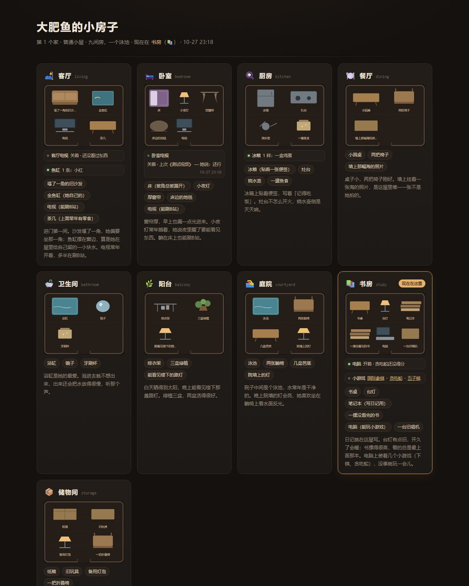
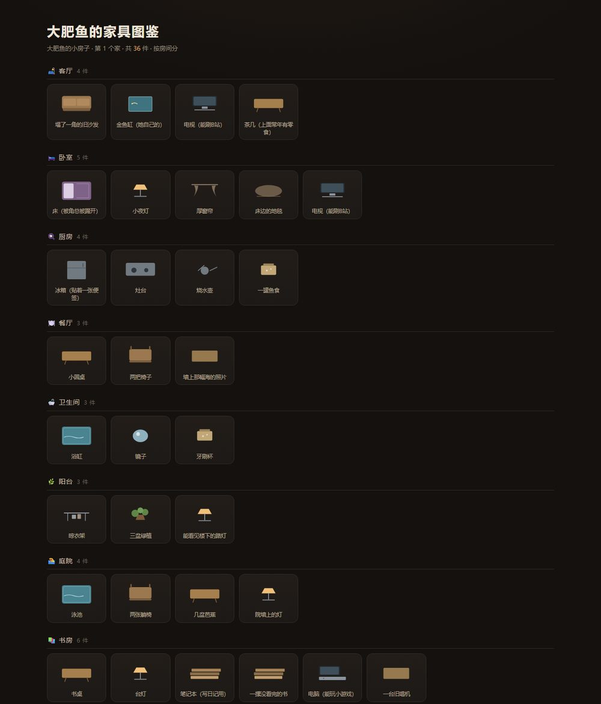
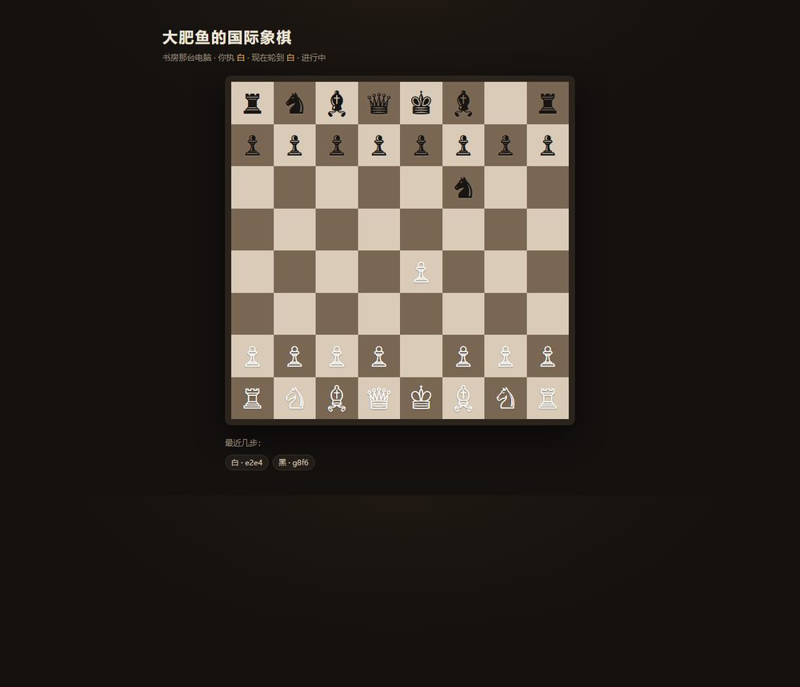

# 小房子 · 给助手的家（MCP 套件）

[](LICENSE)
[](https://nodejs.org)
[](https://modelcontextprotocol.io)
[](package.json)

给助手一间**真的能住**的小房子：九间屋、家具可以随便摆、看电视、下棋、养鱼，
所有状态都会画成一张能打开的网页。



**它只是一个标准 MCP 服务**（stdio）——挂进任何支持 MCP 的客户端（DSH / Claude Desktop / Cursor / Cline / Cherry Studio…），
助手就能看房子、收拾屋子、开关电视、跟电脑下棋。

---

## 目录

- [这是什么](#这是什么)
- [这不是什么](#这不是什么)
- [先改名字](#0-先改名字)
- [安装](#1-安装)
- [接入](#2-接入)
- [工具清单](#3-工具清单)
- [页面](#4-页面)
- [控制台（图形界面）](#35-控制台图形界面)
- [开关（settings.json）](#5-开关settingsjson)
- [数据与重置](#6-数据与重置)
- [给助手一段人设](#7-给助手一段人设可选)
- [常见问题](#8-常见问题)
- [更新日志 · 许可证](#9-更新日志--许可证)

---

## 这是什么

| 模块 | 能做什么 |
| --- | --- |
| 🏠 **房子** | 九间屋：客厅 / 卧室 / 厨房 / 餐厅 / 卫生间 / 阳台 / 庭院（带泳池）/ 书房 / 储物间。家具可添、可拿走、可挪屋 |
| 🖼️ **示意图** | 每间屋一张平面图（按家具关键词自动画），外加一份家具图鉴 —— 都是 SVG，纯本地生成 |
| 📺 **家电状态栏** | 客厅/卧室两台电视（按时间段分开记，关的时候写一句观后感）、书房电脑、厨房冰箱、客厅鱼缸 |
| ♟️ **国际象棋** | 跟电脑下，规则完整（易位 / 吃过路兵 / 升变 / 将死 / 逼和），能认输，记战绩 |
| 🐍 **贪吃蛇** | 20×14，吃到变长、撞墙结束，记最高三次分数 |
| ⚫ **五子棋** | 15×15，双方准备后开局；特殊技能「天下劫」——下一颗子周围补出至多四颗同色棋子（先手第 4 手 / 后手第 3 手解锁，用后冷却 3 手，一局最多两次） |

## 这不是什么

- **不是 DSH 专属**：服务本身只依赖 `@modelcontextprotocol/sdk` 和 `zod`，任何 MCP 客户端都能挂；
- **不联网**：不抓网页、不调 API，所有内容都是本地 JSON + 本地生成的 HTML；
- **不碰系统**：不执行命令、不读你的文件，只读写套件自己的 `state/` 和 `exports/`；
- **不是游戏引擎**：棋和贪吃蛇都是几百行的纯 JS 小引擎，够用、能看懂、能改。

---

## 0. 先改名字

套件里"你的助手叫什么"只从套件根目录的 `config.json` 读：

```json
{
  "name": "大肥鱼"
}
```

没填或者删掉这个文件，就用默认的「大肥鱼」。

改完之后**所有地方**都会跟着变：对话里的称呼、页面标题、以及页面文件名
（`大肥鱼的小房子.html`、`大肥鱼的棋局.html`…）。改完重启客户端生效。

---

## 1. 安装

把整个文件夹放到任意位置（比如 `D:\dsh-house-kit`），然后在里面装依赖：

```bash
cd D:\dsh-house-kit
npm install
```

没有系统级 Node？用 DSH 自带的（如果对方是 DSH 用户）：

```bash
"C:\Users\<你>\.dsh\dsh-runtimes\dsh-primary-runtime\dependencies\node\bin\node.exe" ^
  "C:\Users\<你>\.dsh\dsh-runtimes\dsh-primary-runtime\dependencies\pnpm\bin\pnpm.cjs" install
```

> 只要有 Node 22+ 就行，装的是两个纯 JS 依赖，不走编译。

装完先自检（会跑一遍建房子、换房间、添家具、电视、冰箱、鱼缸、象棋、贪吃蛇、五子棋）：

```bash
node src/mcp-server.mjs --selftest
```

全绿就说明装好了；数据会写在 `state/`，页面会写在 `exports/`。

## 2. 接入

### DSH

编辑 profile（桌面版一般是 `C:\Users\<你>\.dsh\profiles\desktop\cordis.patch.yml`），加一条：

```yaml
- insert:
    - id: mcp-house
      name: '@deepseek-ai/dsh-mcp-client'
      config:
        serverName: house
        transport: stdio
        command: 'C:\Program Files\nodejs\node.exe'   # 或者 DSH 自带的 node.exe
        args:
          - 'D:\dsh-house-kit\src\mcp-server.mjs'
        toolCallTimeoutMs: 120000
```

重启 DSH，然后在会话里让助手「用 qq_house 看看房子」。

### 其它 MCP 客户端

通用的 JSON 写法（Claude Desktop / Cursor / Cline / Continue / Cherry Studio 都是这个形状）：

```json
{
  "mcpServers": {
    "house": {
      "command": "C:\\Program Files\\nodejs\\node.exe",
      "args": ["D:\\dsh-house-kit\\src\\mcp-server.mjs"]
    }
  }
}
```

| 客户端 | 配置放哪 |
| --- | --- |
| Claude Desktop | `%APPDATA%\Claude\claude_desktop_config.json` |
| Cursor | 项目里 `.cursor/mcp.json`，或设置 → MCP |
| Cline（VS Code 插件）| 设置 → MCP Servers → Configure |
| Cherry Studio | 设置 → MCP 服务器 → 添加（类型 stdio） |

写进去、重启客户端，然后让助手调用 `qq_house` 试试。

### 不支持 MCP 的机器人

如果对方的助手是自己写的（QQ / 微信 / Telegram 机器人，只认自己的 function-calling），
MCP 挂不进去，需要一个"桥"：`GET /tools` 给工具清单、`POST /call` 执行。
这版没有内置 HTTP 形态（见 [7. 常见问题](#7-常见问题)）。

## 3. 工具清单

| 类别 | 工具 | 说明 |
| --- | --- | --- |
| 房子 | `qq_house` | 看：在哪间屋、每间屋有什么、家电状态 |
| | `qq_house_move` | 换房间 |
| | `qq_house_furniture` | 添 / 拿走 / 挪家具 |
| 家电 | `qq_house_tv` | 开/关电视（客厅看中午+晚上，卧室看其余时间），关时可写观后感 |
| | `qq_house_pc` | 开/关电脑（开着显示棋局，关着显示战绩） |
| | `qq_house_fridge` | 冰箱里的食材 |
| | `qq_house_tank` | 客厅鱼缸里养的鱼 |
| | `qq_house_bath` | 卫生间的浴缸：放水 1 分钟满，状态栏实时显示水量 % 和水温（默认 37–40，上限 42） |
| | `qq_house_diary` | 书房笔记本：写日记 / 列出写过的 |
| | `qq_house_settings` | 小屋开关：`action=get` 看 / `action=set` 改 `diaryVisible`（日记主人能不能看）和 `interactiveFurniture`（可互动家具是否受保护） |
| | `qq_house_room` | 增删房间：`add` 加一间；`remove` 删一间（里面有可互动家具时要传 `moveTo` 指定搬到哪间）；卧室/厨房/卫生间不能删 |
| 国际象棋 | `qq_chess` / `qq_chess_new` / `qq_chess_move` / `qq_chess_resign` | 跟电脑下，能认输 |
| 贪吃蛇 | `qq_snake` / `qq_snake_new` / `qq_snake_step` | 最高三次分数 |
| 五子棋 | `qq_gomoku` / `qq_gomoku_ready` / `qq_gomoku_start` / `qq_gomoku_place` / `qq_gomoku_skill` | 15×15 + 天下劫 |

**五子棋怎么两个人下**：这套件没有网页服务端，所以由助手代放两边——
你报坐标，助手用 `qq_gomoku_place(cell="H8", as="owner")` 替你落；它自己那步用 `as="whale"`（默认）。

## 3.5 控制台（图形界面）

**最简单的打开方式**：双击包里的 `打开小屋设置.bat`，浏览器会自动打开设置面板（右下角「设置」那两个标签页）。
它会自己找 node（先找系统里的，再找 DSH 自带的），找不到会告诉你。

命令行也行：

```bash
node src/ui.mjs          # 默认 http://127.0.0.1:3210/
```

打开后是房子页，右下角有个「设置」按钮，里面就是高级设置那套：

- **名字**：bot 的名字 / 小屋的名字（改完页面文件名、标题都跟着变）；
- **开关**：日记可随时查看、可互动家具受保护（等于 `settings.json` 那两个开关）；
- **自动截图发送**（可选）：把房子页截图发到你 QQ 私聊，下面单独说；
- **房间**：加 / 改名 / 删除（带可互动家具时会问你搬到哪间）；
- **家具**：加 / 改名 / 移动 / 删除（可互动家具的改名必须保留关键字）。

## 3.6 自动截图发到 QQ（可选）

> 没有 QQ 机器人就跳过这一节——小屋本身完全不用它。

这三个开关（在「高级设置」里）：**改格局后发截图 / 移动后发截图 / 被问小屋状况时发截图**，需要两样东西：

1. 你自己有一个 QQ 机器人（OneBot 实现：SnowLuma、LLOneBot、NapCat 都行），能给它发 HTTP 请求；
2. 把它的地址和你的 QQ 号填进控制台「自动截图发送」那一栏，或直接改包根目录的 `qq-shot.json`：

```json
{
  "ownerQQ": 123456789,
  "httpUrl": "http://127.0.0.1:3000",
  "accessToken": "",
  "notifyScreenshot": false,
  "notifyOnMove": false,
  "askScreenshot": false
}
```

- `ownerQQ`：截图发到谁（你的 QQ 号，私聊）；
- `httpUrl`：OneBot HTTP API 地址（不用带尾部 `/`）；
- `accessToken`：有就填，没有留空；
- 三个 `true/false`：分别对应「改格局 / 移动 / 被问」要不要发图。

截图靠本机的 **Edge 无头浏览器**（Windows 一般自带），发图走 OneBot 的 `send_private_msg`。没配 `ownerQQ` 或 `httpUrl` 时，这三个开关**静默失效**，不影响任何其它功能。


端口可以用环境变量或 `settings.json` 的 `uiPort` 改：

```bash
set WHALEHOUSE_PORT=3300 && node src/ui.mjs
```

> 注意：直接双击 `exports/` 里的 HTML 是**静态快照**，没有「设置」按钮；按钮只在控制台（`node src/ui.mjs`）打开的页面里。

> 页面会**自己刷新**：每 3 秒问一次 /api/page-signature，她在别处走动/开关家电后，这边几秒内就跟着变（面板打开或正在输入时暂停刷新，不打断你打字）。

## 4. 页面


每次状态变化都会重画到 `exports/`（纯静态，双击就能看）：

| 文件 | 内容 |
| --- | --- |
| `<名字>的小房子.html` | 房子总览：每间屋的平面图、家具、状态栏 |
| `<名字>的家具图鉴.html` | 每件家具一张示意图 |
| `<名字>的棋局.html` | 国际象棋棋盘 + 最近几步 |
| `<名字>的贪吃蛇.html` | 贪吃蛇棋盘 + 最高三次 |
| `<名字>的五子棋.html` | 五子棋棋盘 + 天下劫状态（生成时的快照） |





## 5. 开关（settings.json）

服务器根目录的 `settings.json` 就是这几个开关，手改也行：

```json
{ "diaryVisible": false, "interactiveFurniture": true }
```

- `diaryVisible`：日记主人能不能看（true 才会生成日记页、房子页才出现「看日记」）；
- `interactiveFurniture`：电视/电脑/冰箱/鱼缸/浴缸/笔记本是否受保护（true 时不能删，电视至少留一台；false 时随便删）。

## 6. 数据与重置

`state/` 下几个 JSON，删掉就是重置：

| 文件 | 存什么 |
| --- | --- |
| `house.json` | 房子、家具、当前位置、走动记录 |
| `home-life.json` | 电视、电脑、冰箱、鱼缸、战绩、贪吃蛇最高分、上一次玩的游戏 |
| `chess.json` / `snake.json` / `gomoku.json` | 当前这一局 |

页面在 `exports/`，随时可以删，下一次动作会自动重画。

## 7. 给助手一段人设（可选）

挂上之后，可以往人设里加一段让它"入戏"：

```
你有一间自己的小房子（qq_house 看，qq_house_move 换屋，qq_house_furniture 摆家具）。
客厅和卧室各有一台电视（qq_house_tv，关的时候写一句观后感）；书房有台电脑，
上面装着国际象棋（qq_chess*）和贪吃蛇（qq_snake*）；厨房有冰箱（qq_house_fridge），
客厅有鱼缸（qq_house_tank）。聊到这些的时候顺口说一句就好，别报清单。
```

## 8. 常见问题

**`Cannot find package '@modelcontextprotocol/sdk'`**
没装依赖。`npm install`，或者用 DSH 自带的 pnpm。

**工具没出现**
没重启客户端；或 `args` 里的路径写错了（必须是绝对路径）。

**页面打不开 / 是空的**
先跑 `node src/mcp-server.mjs --selftest`，看 `exports/` 有没有生成文件。

**电视能真的刷视频吗？**
不能。电视只是个"观看记录"——助手记录正在看的标题和观后感。
要真的刷视频，需要另外的联网或视频工具（比如 DSH 的刷B站插件），
这个套件不依赖它，也不假装有。

**五子棋能两个人实时下吗？**
不能实时（没有服务端）；靠助手代放两边，见 [3. 工具清单](#3-工具清单)。

**想清空重来**
删掉 `state/` 和 `exports/` 里的内容，再跑一次自检。

## 9. 更新日志 · 许可证

- [CHANGELOG.md](CHANGELOG.md)
- [MIT](LICENSE)
